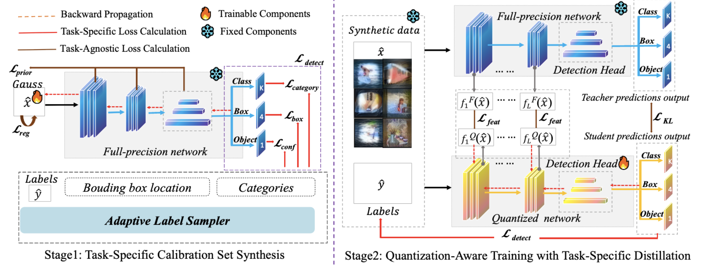

<div align="center">

# Task-Specific Zero-shot Quantization-Aware Training 				for Object Detection

[](LICENSE)
[](https://arxiv.org/abs/2507.16782)
[](https://dfq-dojo.github.io/dfq-toolkit-webpage/)

</div>

> [!NOTE]
> 📢 **Unified and Extensible!** This repo offers a **plug-and-play** *Zero-Shot QAT* framework for four major object detection backbones — **YOLOv5**, **YOLO11**, **Mask R-CNN**, and **ViT**. Ideal for **researchers** and **practitioners** looking to build on a **robust** and **versatile foundation**.
>
> 🔥 **Accepted at ICCV 2025!**
>

## Overview

We introduce a novel framework that enables task-specific zero-shot quantization of object detection networks, ensuring high performance even in the absence of real data or retraining resources.

Our contributions are threefold:

- **Diagnosing the Limitations of Task-Agnostic Calibration**:  
  We show that task-agnostic synthetic data often fails to reflect the structure of object detection tasks. Our method emphasizes the use of *task-specific* synthetic data, better aligning with real-world detection patterns.

- **Task-aware Synthetic Image Generation for Detection**:  
  We propose a new bounding-box sampling method that synthesizes object-centric images by reconstructing object category distributions, spatial layouts, and size priors—*without relying on any real data*.

- **Task-specific Quantized Network Distillation**:  
  We integrate task-aware fine-tuning into the quantized network distillation process, restoring detection performance while maintaining the compactness and efficiency of quantized models.

<p align="center">
  
</p>


## 📁 Repository Structure

All detectors share one Python package, `dfq`, on Python 3.14, managed by [uv](https://docs.astral.sh/uv/).

| Path | Content |
|------|---------|
| `src/dfq/` | The package: quantization, distillation, image generation, training, detector adapters |
| `scripts/` | One script per stage: `labels.py`, `generate.py`, `qat.py`, `evaluate.py` |
| `configs/` | One TOML config per detector and stage |
| `docs/` | [User manual](docs/user-manual.md), [architecture](docs/architecture.md), designs, results |
| `tests/` | Unit tests that run on CPU |
| `tools/` | Dataset download |
| `vit/`, `yolo11/`, `yolov5/` | The old per-detector projects, until each moves into `dfq` |

ResNet-50 Mask R-CNN already runs on `dfq`. The move is described in
[`docs/design/unified-package.md`](docs/design/unified-package.md).

To start, follow the [user manual](docs/user-manual.md):

```bash
uv sync --extra cu132 --extra vit --extra yolo
uv run --no-sync python scripts/generate.py configs/resnet50/generate.toml
```

## 🎀 Pretrained Model

Please refer to the [huggingface page](https://huggingface.co/papers/2507.16782) to see the pretrained model of [YOLOv5](https://huggingface.co/collections/DFQ-Dojo/yolov5-dfq-models-68a090a174a34dcb4c86c075), [YOLO11](https://huggingface.co/collections/DFQ-Dojo/yolo11-dfq-models-68a5982368c66014ff20ed3f) and [ViT](https://huggingface.co/collections/DFQ-Dojo/swin-transformer-dfq-models-68bda92e4795f9294ac3b2eb) series.

## 🎈 TODO

1. Release pretrained weights of Resnet based masked rcnn models.
2. Release instructions of the evaluation of models.
3. Convert model to a universal and ergomatic format.

## 📜 License

This project includes code from [Ultralytics](https://github.com/ultralytics/ultralytics) and is therefore distributed under the **AGPL license** in compliance with their licensing terms.

## 🤝 Contribution

We welcome community contributions!  
If you find a bug or have an enhancement idea, feel free to open an issue or submit a pull request.

## 📚 Citation

If you find our work helpful, please consider citing:

```bibtex
@misc{li2025taskspecificzeroshotquantizationawaretraining,
      title={Task-Specific Zero-shot Quantization-Aware Training for Object Detection}, 
      author={Changhao Li and Xinrui Chen and Ji Wang and Kang Zhao and Jianfei Chen},
      year={2025},
      eprint={2507.16782},
      archivePrefix={arXiv},
      primaryClass={cs.CV},
      url={https://arxiv.org/abs/2507.16782}, 
}
